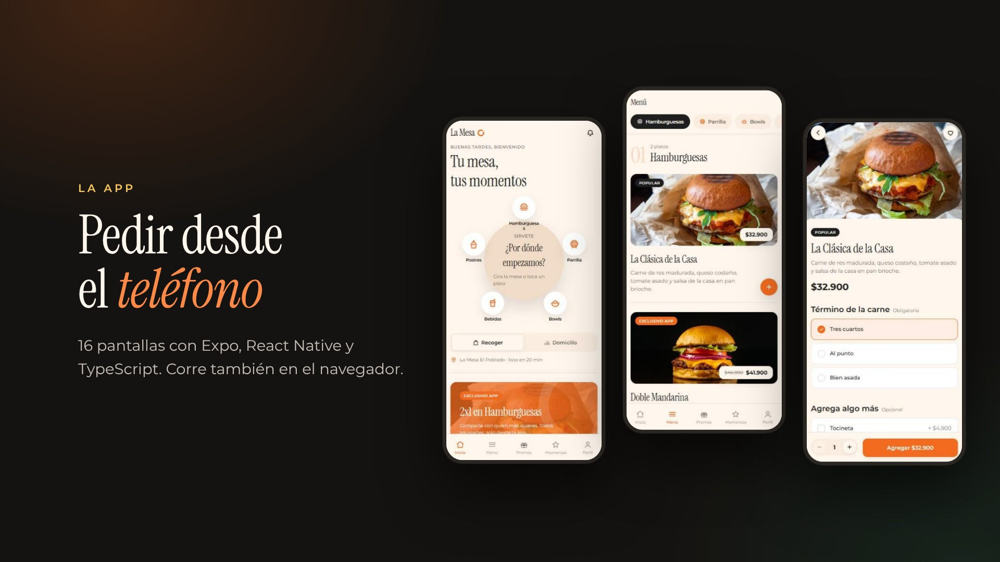

<div align="center">

# La Mesa

**Sistema completo de pedidos para un restaurante: app móvil, panel de cocina y backend.**

*Donde todo se comparte*

[](https://github.com/danielbuitragoh/la-mesa/actions/workflows/verificar.yml)

[**Ver la app**](https://danielbuitragoh.github.io/la-mesa/app-web/) · [**Ver el panel de cocina**](https://danielbuitragoh.github.io/la-mesa/panel/panel-admin.html?demo) · [Ver el prototipo](https://danielbuitragoh.github.io/la-mesa/prototipo/la-mesa-app.html) · [Cómo se construyó](docs/BRIEF.md)

[](https://danielbuitragoh.github.io/la-mesa/#video)

<sub>▶ El vídeo de un minuto está en [la página del proyecto](https://danielbuitragoh.github.io/la-mesa/#video) · [archivo mp4](docs/video/la-mesa.mp4)</sub>

🎨 **Dirección creativa:** [Gabriela Chávez Castellano](https://www.instagram.com/gabrielae.cc)
</div>

---

## Qué es

Un proyecto personal donde diseñé y construí el sistema completo que necesitaría un restaurante para vender por su cuenta, sin ceder el 30% de comisión a una plataforma de delivery: la app del cliente, el tablero que usa la cocina y el backend que los conecta.

La marca —identidad visual, tono, nombre— es ficticia y la creé para el proyecto. El punto no es el restaurante: es mostrar cómo llevo algo desde una imagen de design system hasta un sistema que compila, se verifica solo y se puede desplegar.

**Los enlaces de arriba funcionan.** No son videos ni mockups: la app y el panel corren en el navegador contra el backend real, con datos de demostración. El prototipo es un recorrido visual sin backend, para navegarlo más rápido. Se pueden tocar.

**El panel entra solo** con una cuenta de cocina de demostración (`cocina@lamesa.co` / `lamesa2026`). Ve los mismos pedidos que el equipo real, pero es de solo lectura, y no porque la interfaz lo esconda: en la base tiene `es_demo = true` y todas las políticas de escritura del equipo exigen `es_staff_editor()`, que la excluye. Como esas credenciales son públicas, cada cuenta está limitada a 1 pedido por minuto y 5 por hora con un trigger en la base, no en la app. Todo está en [`supabase/cuenta-demo.sql`](supabase/cuenta-demo.sql).

## Lo que más me interesa que se mire

**Mesa Compartida.** El lema de la marca es "donde todo se comparte", así que lo convertí en pantalla en vez de dejarlo en el eslogan: abres una mesa, compartes un código de seis caracteres, y quienes se sientan contigo aparecen alrededor del anillo, cada uno con lo suyo. Al cerrar, cada uno paga su parte o alguien invita. Hoy está el diseño, la pantalla y las tablas, y en la demo corre con comensales de ejemplo; qué falta para que sea real está dicho [más abajo](#lo-que-no-está-hecho).

**La mesa que gira.** El menú no arranca como una lista sino como una mesa vista desde arriba, con las categorías servidas alrededor. Se gira con el dedo —y encaja sola en el plato más cercano al soltar, con su punto de inercia— o se toca un plato y la mesa gira hasta traerlo al frente antes de abrir esa categoría. La navegación y la metáfora de la marca son el mismo gesto, no dos cosas pegadas.

**El anillo.** El isotipo es un anillo abierto —una mesa vista desde arriba— y lo usé como dispositivo estructural en toda la app: rodea a quienes comparten mesa, se llena a medida que avanza el pedido, marca el progreso hacia el siguiente nivel de fidelidad. Es el único gesto decorativo que me permití; todo lo demás se mantiene sobrio.

**El precio lo pone la carta, no el teléfono.** Quien tenga la app puede llamar a la API sin pasar por ella, así que la base no se cree ninguna cifra que le manden: al guardar un pedido, el nombre y el precio de cada plato salen de la carta, las opciones que no existan se descartan, el cupón se comprueba —vigencia, mínimo, usos— y el total se suma en un disparador. Lo mismo con el perfil: la seguridad por fila decide qué filas ve cada quien, y los permisos de columna impiden que alguien se cambie el rol o se regale puntos. Está en [`supabase/endurecimiento.sql`](supabase/endurecimiento.sql) y lo comprueban 57 pruebas que entran con el rol de un cliente, de la cuenta demo y de cocina.

**La seguridad del pago.** El monto a cobrar nunca sale del teléfono. La app manda solo el id del pedido y el servidor lee de la base el total que la propia base calculó antes de firmar. En el otro sentido, la app nunca decide que un pago salió bien: eso lo confirma la pasarela contra un webhook cuyo checksum se valida. Quien tenga el APK puede leer cualquier cosa que esté dentro de la app, así que el secreto de integridad vive en el servidor y nada más. Detalles en [`supabase/functions/README.md`](supabase/functions/README.md).

**Que no se rompa sin que nadie se entere.** Cada push corre seis verificaciones distintas, incluidas tres que escribí para este proyecto: una levanta el esquema entero en un PostgreSQL vacío y le lanza las 57 pruebas de seguridad; otra mide el contraste de los catorce pares de color de la paleta contra WCAG AA, y otra comprueba que cada tabla, columna y estado que el código le pide a la base exista de verdad en el esquema.

## Cómo está armado

| Pieza | Qué es | Stack |
|---|---|---|
| [`app-movil/`](app-movil/) | App del cliente, iOS, Android y web · 16 pantallas | Expo · React Native · TypeScript · Zustand |
| [`panel/`](panel/) | Tablero de cocina y gestión de menú | HTML, CSS y JS sin dependencias |
| [`supabase/`](supabase/) | 20 tablas con seguridad por fila y por columna, precios calculados en la base, 57 pruebas y 3 funciones de servidor | PostgreSQL · Deno Edge Functions |
| [`prototipo/`](prototipo/) | Prototipo navegable, previo al código real | HTML de un solo archivo |
| [`docs/`](docs/) | Brief, capturas, verificador de contraste y de esquema | Python · Node |

<table>
<tr>
<td width="50%"></td>
<td width="50%"></td>
</tr>
<tr>
<td><b>Tablero de cocina.</b> Cuatro columnas, cambio de estado en un toque y un reloj por pedido que pasa de gris a ámbar a rojo según se demora. Aviso sonoro generado en el navegador, sin archivos externos.</td>
<td><b>Editor de foto.</b> El encuadre se decide una vez y alimenta las tres formas donde la app usa la imagen, con vista previa de cada una. Nadie sube una foto bonita que queda decapitada en el carrito.</td>
</tr>
</table>

## Decisiones que tomé y por qué

**Supabase en vez de un backend propio.** Necesitaba tiempo real para que el cambio de estado en cocina llegue al teléfono del cliente, seguridad por fila para que nadie vea pedidos ajenos, y almacenamiento para las fotos. Escribir eso a mano habría sido semanas de trabajo que no demuestran nada nuevo.

**El panel sin framework.** Es una herramienta interna que corre en una tablet en una cocina. React ahí serían 200 KB y un paso de compilación a cambio de nada. Un archivo HTML que se abre y funciona es la respuesta correcta, y sostener esa decisión también es criterio.

**Entrar sin contraseña.** Un código de seis dígitos al correo, o la cuenta de Google. Una contraseña menos que recordar, una menos que recuperar, y una menos que se pueda filtrar. El acceso con Google va por flujo PKCE: el token nunca viaja expuesto en la URL.

**Modelo híbrido de domicilio.** La app controla el pedido, el pago y la relación con el cliente; el transporte se contrata por viaje a una mensajería. Sin flota propia y sin ceder el dato del cliente a una plataforma.

**Multi-sede desde el primer día.** El esquema soporta varias sedes y monedas aunque solo haya una. Es barato hacerlo al principio e imposible después.

**El código está en español.** Nombres de variables, funciones y comentarios. Es un proyecto de una marca colombiana y el equipo que lo mantendría hablaría español; me pareció más honesto que traducir a medias.

**Todo degrada en vez de romperse.** Si una foto no carga, aparece el tejido de color de su categoría, no un recuadro roto. Si no hay backend, la app arranca en modo demostración con la carta completa. Si la tipografía de la marca no está licenciada, se usa una sustituta parecida. Nada de esto pide una pantalla de error.

## Lo que verifiqué

La mayoría de proyectos de portafolio no tienen forma de comprobar que funcionan. Este sí, y corre solo en cada push:

```bash
cd app-movil && npx tsc --noEmit                     # TypeScript sin errores
cd app-movil && npx expo export --platform android   # el bundle resuelve entero
python3 docs/contraste.py                            # 14 pares de color pasan WCAG AA
node supabase/functions/_pruebas/firma.prueba.mjs    # 11 pruebas de firma y checksum
node docs/revisar-esquema.mjs                        # el código concuerda con las 20 tablas
bash supabase/pruebas/probar.sh                      # 57 pruebas de seguridad contra PostgreSQL
```

El verificador de contraste nació de un problema real: medí la paleta de la marca y cuatro usos no pasaban el mínimo de legibilidad. El naranja mandarina como precio de 13 px daba 2,85 sobre 4,5 requerido. La solución no fue cambiar la marca sino separar los usos —la paleta original para superficies y acciones, variantes más profundas del mismo tono para texto— y dejar el verificador para que no se degrade sin que nadie se entere.

Las pruebas de firma comprueban contra el ejemplo publicado por Wompi que mi hash coincide con el suyo, y que un checksum alterado, un monto manipulado o un secreto equivocado se rechacen.

Las pruebas de seguridad nacieron de tres agujeros de verdad. El esquema compilaba y la demo funcionaba, pero cualquier cuenta podía cambiarse el rol —también la cuenta demo de cocina, cuya contraseña es pública, que así dejaba de ser de solo lectura—, el total del pedido era el que mandaba la app, y se podían añadir platos a un pedido ya entregado. Las pruebas se escribieron primero contra el esquema viejo, para verlas fallar, y después contra el endurecido. No prueban la interfaz: entran como entraría alguien con la clave pública y la consola abierta.

El verificador de esquema es el que más veces me ha salvado: recorre los 56 archivos que tocan la base y falla si el código consulta una tabla, una columna o un estado que el esquema no tiene. Un `select` mal escrito no llega a producción para descubrirse ahí.

## Correrlo

**La app:**

```bash
cd app-movil
npm install
npm start        # escanea el QR con Expo Go
```

Arranca en modo demostración con el menú completo, carrito, cupones y puntos. Para conectarla a un backend real: copiar `.env.example` a `.env`, correr en orden `schema.sql`, `seed.sql`, `correcciones.sql`, `cuenta-demo.sql` y `endurecimiento.sql` de [`supabase/`](supabase/), y pegar las credenciales. La app detecta sola que hay backend.

**El panel y el prototipo:** abrir el `.html` en el navegador. No hay nada que instalar. El prototipo acepta enlace directo a cualquier pantalla —`la-mesa-app.html#seguimiento`— para enseñar una sola sin navegar hasta ella.

## Lo que no está hecho

Prefiero decirlo a que se note.

La Mesa Compartida no comparte todavía. Abrir la mesa, el código y la pantalla existen, igual que las tablas `mesas` y `mesa_participantes`, pero cada quien sigue pidiendo desde su propio carrito y la pantalla enseña comensales de ejemplo. Para que sea real faltan las políticas que dejen a los comensales de una mesa verse entre sí sin exponer su perfil entero, y una tabla de platos por mesa que se sincronice en vivo.

El cobro es simulado. La integración con Wompi está escrita y probada —firma de integridad, webhook con checksum—, pero sin credenciales de la pasarela el pedido nace ya pagado. `sanear_pedido()` deja anotado qué cambia el día que haya pasarela real.

La asignación de mensajero es manual desde el panel, no por API.

Las notificaciones tienen dos categorías —pedidos y promociones— que la persona activa o apaga desde Perfil, pero ese filtro hoy solo vive en el teléfono: el servidor todavía manda ambas al mismo token, no separa por categoría al enviar.


---

<details>
<summary><b>In English</b></summary>

**La Mesa** is a complete ordering system for a restaurant: a React Native customer app, a real-time kitchen dashboard, and a PostgreSQL backend with signed payment flows.

Built as a personal project. The brand is fictional and I designed it for this — the point is showing how I take something from a design system image to a system that compiles, verifies itself, and can be deployed.

Both demo links at the top are live and interactive, running on demo data. The kitchen panel signs in by itself with a read-only demo account enforced by row-level security, and order creation is rate-limited in the database. Highlights: a shared-table screen built around the brand's ring (designed and prototyped; live cart sharing between phones is listed as not done); a category picker shaped like a turntable you actually spin with your finger; order totals computed in the database rather than trusted from the client, checked by 57 security tests that run against a real PostgreSQL; server-side payment signing; and two checkers I wrote for this project — one that measures the brand palette against WCAG AA, and one that fails the build if the code queries a table, column or state the schema doesn't have.

Code and comments are in Spanish — it's a Colombian brand and the team maintaining it would speak Spanish.

</details>

<div align="center">
<sub>Proyecto personal · marca ficticia · <a href="LICENSE">MIT</a></sub>
</div>
